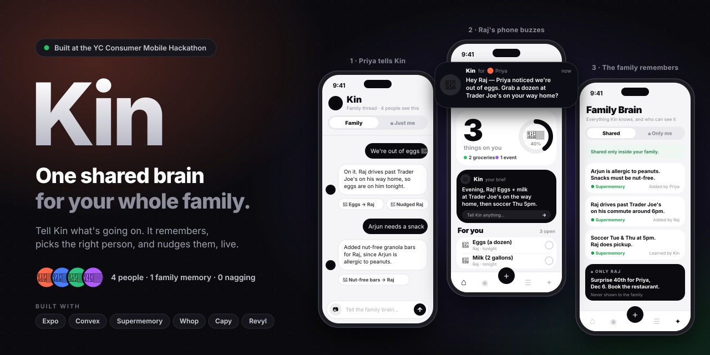
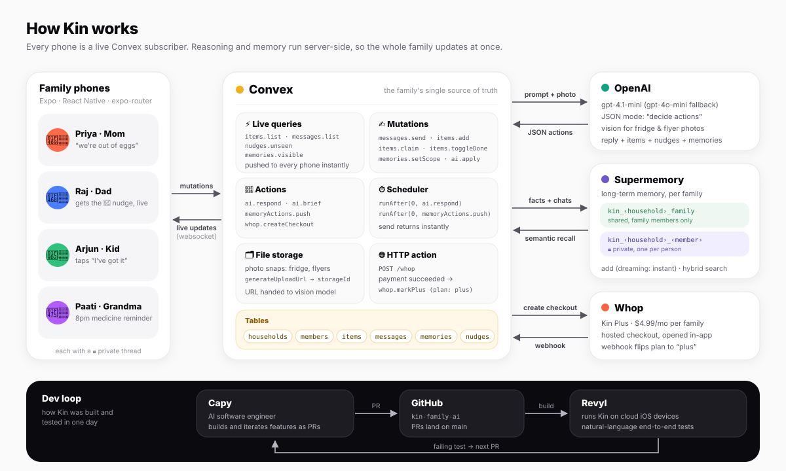
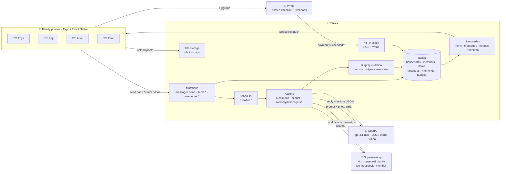
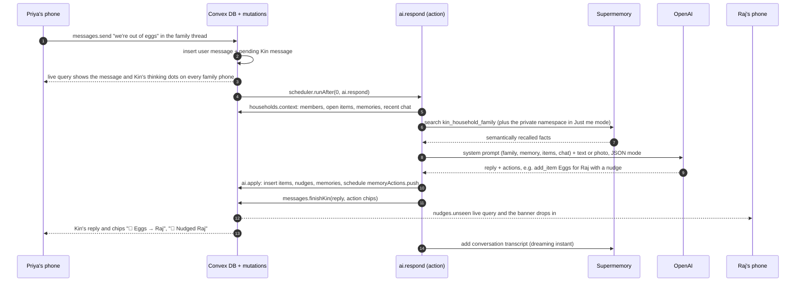

<div align="center">



# Kin

**One shared brain for your whole family.**

Tell Kin what's happening at home. It remembers, picks the right person, and nudges their phone, live.

[](https://expo.dev)
[](https://reactnative.dev)
[](https://convex.dev)
[](https://supermemory.ai)
[](https://whop.com)
[](https://capy.ai)
[](https://revyl.ai)
[](https://www.typescriptlang.org)
[](#license)

**Live demo:** https://vnmoorthy.github.io/kin-family-ai/ (web build) · **Pitch deck:** https://vnmoorthy.github.io/kin-family-ai/deck/

</div>

---

## Why Kin

Every family has a human router. Usually it's mom. She notices the eggs are gone, remembers that Arjun can't have peanuts, knows Dad drives past Trader Joe's, and then texts, reminds, and re-reminds until it's done. It's invisible, it never ends, and it all lives in one person's head.

Group chats don't fix this. They spread the noise around and leave the thinking with the same person. Shared to-do apps don't fix it either, because someone still has to decide who does what.

**Kin takes over the routing.** Everyone in the family talks to the same AI. It knows what each person knows, merges it into one family memory, decides who should handle each thing, and nudges that person's phone. When they finish, it tells whoever asked. The coordinator is Kin now, not mom.

## How it works, in 30 seconds

> **5:42 PM.** Priya opens the fridge. No eggs. She types **"we're out of eggs 🥚"** into Kin.
>
> Kin checks the family memory: *Raj drives past Trader Joe's on his commute home around 6pm.* It adds **Eggs → Raj** to the grocery list and writes him a note.
>
> **5:42 PM, same second.** Raj's phone shows a banner:
> **🥚 "Hey Raj — Priya noticed we're out of eggs. Grab a dozen at Trader Joe's on your way home?"**
>
> **6:15 PM.** Raj checks it off in the store. Priya gets **"✅ Raj finished 'Eggs'"**. Nobody had to text anybody.

It works for photos too. Snap the fridge and Kin lists what's low. Snap a school flyer and Kin creates the event, the permission slip, and the thing to bring, each assigned to the right person. Because it remembers that **Arjun is allergic to peanuts**, the field-trip snack it adds is nut-free.

## Features

- 🧠 **One family memory.** Allergies, routines, commutes, who handles school forms. Teach it by chatting, or add facts in the Family Brain.
- 🎯 **Smart assignment.** Kin uses that memory to pick the best person for each item, so it doesn't all land on whoever spoke.
- 🔔 **Live nudges.** A banner drops onto the assignee's phone the moment Kin assigns something. It's a live Convex query, so there's no polling and no refresh.
- 🔒 **"Just me" mode.** A private thread and a private memory that Kin never shows to the rest of the family. Use it for surprise parties, gifts, or venting.
- 📷 **Snap anything.** Fridge, pantry, school flyer, homework, receipt. A vision model turns the photo into items.
- 🙋 **"I've got it."** Anyone can claim an item. Whoever had it, and whoever asked, gets told.
- ✅ **Closing the loop.** When something is done, the person who asked for it gets a "✅ finished" nudge.
- ☀️ **Personal brief.** A greeting by name with your most urgent items first, plus one family heads-up, written fresh whenever you open Home.
- 📋 **Shared lists.** Groceries, tasks, events, and reminders. Filter by person, quick-add with an assignee, toggle done.
- 🔥 **Family streak and rings.** A big "things on you" number, a progress ring for each person, and a streak for every day someone gets something done.
- 👨‍👩‍👧 **Join in seconds.** Start a family, share a 6-letter code, and everyone's in. You can also load a sample family (Priya, Raj, Arjun, Paati) to try it right away.
- 💎 **Kin Plus.** A $4.99/mo family plan, sold through Whop's hosted checkout.

### Screens

| Screen | What's on it |
|---|---|
| **Onboarding** | Start a family or join with a 6-letter code. Optional "Fill with a sample family". |
| **Home** | Big "N things on you" number and progress ring, the Kin brief card, *For you*, *Family today* rings, *Recently handled*, 🔥 streak |
| **Kin** | *Family* thread vs 🔒 *Just me*, camera and photo snap, suggestion chips, action chips under each Kin reply ("🥚 Eggs → Raj", "🔔 Nudged Raj") |
| **Lists** | Groceries / Tasks / Events / Reminders, filter by person, quick add with assignee, "I've got it", pass to someone else |
| **Family Brain** | *Shared with family* vs *Only me* memories, teach Kin, make private / share, forget, ● Supermemory sync badge |
| **Family sheet** | Invite code (copy / share), members, "Be ‹name›" profile switch, Kin Plus via Whop, sample data / reset |

The design is monochrome on purpose: big bold numbers, soft white cards, and one black floating **＋** button.

## Privacy model

Kin keeps two kinds of memory, and the split is enforced on the server, not just in the UI.

| | **Family memory** | **Private memory ("Just me")** |
|---|---|---|
| Stored as | `memories` row with `scope: "family"` | `memories` row with `scope: "private"` and `ownerId` |
| Supermemory namespace | `kin_<household>_family` | `kin_<household>_<member>` |
| Who can read it | Every member of *that* household | Only the owner |
| When Kin uses it | Every message in that household | Only when the **owner** is chatting in 🔒 Just me, and in the owner's own Home brief |
| Chat thread | `messages.visibility = "family"`, seen by the whole family | `visibility = "private"`, `threadOwnerId = owner`, seen only by the owner |

What the code guarantees:

- **Nothing crosses households.** Every query, mutation, and prompt is keyed by `householdId`, and Supermemory namespaces are per household.
- **`memories.visible`** returns family memories plus *only the caller's own* private memories. Other people's private memories never leave the server.
- **`messages.list`** in private mode returns only messages whose `threadOwnerId` is the caller. Nobody else's private thread is ever sent to a phone.
- **The AI only sees your private memory when you're talking to it privately.** `ai.respond` adds the speaker's private memories to the prompt, and searches their private Supermemory namespace, only when the message came from 🔒 Just me. Family-thread context leaves out every private message. The prompt also tells the model never to reveal private memory and never to put it in a nudge.
- **Private chats stay private in long-term memory.** A "remember" from a private chat is saved as private by default, and the private conversation transcript goes into the speaker's own namespace, not the family's.

> **Hackathon-build caveats (things we'd fix before shipping):**
> - Identity is a device session: a household id and member id stored in AsyncStorage, and "Be ‹name›" switches between them. There are no authenticated accounts yet, so Convex functions trust the `memberId` they receive. Next step: Convex Auth, with the member derived from the auth identity.
> - Lists have no scope. If Kin creates a list item from a private chat, it lands on the family's shared lists.
> - "Forget this" deletes the Convex row, and changing a memory's scope copies it into the new Supermemory namespace. Neither one deletes the earlier Supermemory document yet.
> - The Whop webhook doesn't verify its signature yet.

## Architecture

<p align="center"></p>



### Message lifecycle

What happens between "we're out of eggs" and Raj's phone buzzing:



The model never writes to the database directly. It returns a small set of typed actions (`add_item`, `complete_item`, `remember`, `nudge`), and `ai.apply` validates them and applies all of them in one Convex transaction. Member names are matched against the real household, at most 12 actions are applied per reply, and nobody gets a nudge about something they asked for themselves.

### Data model

All tables live in [`convex/schema.ts`](convex/schema.ts).

| Table | Key fields | Indexes | Purpose |
|---|---|---|---|
| `households` | `name`, `code` (6 letters), `plan` (`free` \| `plus`), `brief?`, `createdAt` | `by_code` | One family. The code is how others join. |
| `members` | `householdId`, `name`, `emoji`, `color`, `role`, `lastSeenAt` | `by_household` | Each person in the family |
| `items` | `householdId`, `kind` (`task` \| `grocery` \| `event` \| `reminder`), `title`, `emoji?`, `assigneeId?`, `createdById?`, `status` (`open` \| `claimed` \| `done`), `dueLabel?`, `source` (`kin` \| `manual` \| `snap`), `doneAt?`, `doneById?` | `by_household`, `by_household_status` | Shared lists. Drives Home, Lists, and the streak. |
| `messages` | `householdId`, `authorId?`, `role` (`user` \| `kin`), `text`, `visibility` (`family` \| `private`), `threadOwnerId?`, `imageId?`, `actions?`, `pending?` | `by_household` | Family thread plus one private thread per person |
| `memories` | `householdId`, `ownerId?`, `scope` (`family` \| `private`), `text`, `source` (`kin` \| `manual`), `synced?` | `by_household` | Live mirror of the family brain. `synced` turns on once Supermemory confirms. |
| `nudges` | `householdId`, `toId`, `fromId?`, `text`, `emoji`, `itemId?`, `seen` | `by_to_seen` | The banners that drop onto a phone |

## Built with

| | How Kin uses it |
|---|---|
| **[Capy](https://capy.ai)** | Our AI software engineer. We built and iterated on Kin by handing Capy tasks and reviewing the PRs it opened against this repo. |
| **[Revyl](https://revyl.ai)** | Runs Kin on cloud iOS devices with natural-language tests, like "create a family, load the sample family, send 'we're out of eggs', expect a nudge for Raj". Failures go back to Capy as the next task. |
| **[Convex](https://convex.dev)** | The whole backend. Every list, chat thread, memory, and nudge is a **live query**, so every family phone updates as soon as data changes. **Mutations** handle sends, claims, and check-offs. **Actions** call OpenAI, Supermemory, and Whop. The **scheduler** runs `ai.respond` and memory sync right after a send, so the UI never waits. **File storage** holds photo snaps. An **HTTP action** (`POST /whop`) receives Whop's webhook. |
| **[Supermemory](https://supermemory.ai)** | Kin's long-term memory. Each family gets a shared namespace `kin_<household>_family`, and each person gets a private one, `kin_<household>_<member>`. Every fact and every conversation turn is added with `dreaming: "instant"` so Supermemory extracts memories from it, and every message runs a hybrid semantic search to recall relevant facts. Convex keeps a live mirror, so the app still works if Supermemory is slow. |
| **[Whop](https://whop.com)** | Payments for **Kin Plus** ($4.99/mo per family). `whop.createCheckout` creates a hosted checkout configuration with the `householdId` in its metadata, and the app opens it in-app. When the payment succeeds, Whop's webhook hits `/whop`, which sets that household's `plan` to `plus`. |
| **OpenAI** | `gpt-4.1-mini`, falling back to `gpt-4o-mini`, in JSON mode with vision. One "decide actions" prompt turns text or a photo into a reply plus structured actions. |
| **Expo / React Native** | Expo SDK 58, expo-router, expo-image-picker for snaps, expo-haptics, expo-clipboard, and expo-web-browser for checkout. All in TypeScript. |

## Quickstart

**Prerequisites:** Node 20+, the [Expo Go](https://expo.dev/go) app on your phone, and a free [Convex](https://convex.dev) account.

```bash
git clone https://github.com/vnmoorthy/kin-family-ai.git
cd kin-family-ai
npm install

# 1. Backend: creates a Convex deployment and writes EXPO_PUBLIC_CONVEX_URL to .env.local
npx convex dev

# 2. Secrets (in a second terminal)
npx convex env set OPENAI_API_KEY sk-...
npx convex env set SUPERMEMORY_API_KEY sm_...
npx convex env set WHOP_API_KEY ...

# 3. App
npx expo start
```

Scan the QR code with Expo Go (or press `i` for the iOS simulator, `w` for web). Tap **Start a family**, keep **Fill with a sample family** on, and you're in.

<details>
<summary><b>Optional configuration</b></summary>

| Variable | Default | What it does |
|---|---|---|
| `OPENAI_MODEL` | `gpt-4.1-mini` | Primary model. Falls back to `gpt-4o-mini` if this one fails. |
| `WHOP_API_BASE` | `https://sandbox-api.whop.com/api/v1` | Set to the production API to take real payments |
| `WHOP_PLAN_ID` | none | Use an existing Whop plan for checkout |
| `WHOP_COMPANY_ID` | none | Create a $4.99 / 30-day renewal plan on the fly |

Point your Whop webhook at `https://<your-deployment>.convex.site/whop` and subscribe it to payment succeeded and membership activated events.

Without `OPENAI_API_KEY`, Kin replies with a setup hint. Without `SUPERMEMORY_API_KEY`, long-term memory is skipped and Kin runs on the Convex mirror.
</details>

## Project structure

```
kin/
├── convex/                  # Backend (Convex)
│   ├── schema.ts            # households · members · items · messages · memories · nudges
│   ├── ai.ts                # ai.respond (the brain), ai.apply (actions → DB), ai.brief
│   ├── memoryActions.ts     # Supermemory client: namespaces, add (dreaming), search, sync
│   ├── memories.ts          # Family Brain: visible, add, setScope, remove
│   ├── messages.ts          # Threads: list (family / private), send, photo upload URL
│   ├── items.ts             # Lists: add, claim ("I've got it"), toggleDone (close the loop), reassign
│   ├── nudges.ts            # Live banners: unseen, markSeen
│   ├── households.ts        # Create / join by code, members, context, sample-family seed
│   ├── whop.ts              # Kin Plus checkout + markPlus
│   └── http.ts              # POST /whop webhook
├── src/
│   ├── app/                 # expo-router: _layout (Convex provider), index (tabs + ＋ sheet)
│   ├── screens/             # Onboarding · Home · Kin · Lists · Brain · Family
│   ├── components/          # NudgeBanner, UI kit (Card, Ring, ItemRow, Sheet, …)
│   └── lib/                 # session, snap (pick + upload), theme
├── docs/                    # hero.svg, architecture.svg, DEMO.md
└── app.json
```

## Demo script (2 minutes)

The full runbook, with fallbacks, is in **[docs/DEMO.md](docs/DEMO.md)**.

1. **Priya's phone:** start "The Sharma Home" with the sample family. Show Home: "things on you", the ring, the brief, and the 🔥 streak.
2. **Raj's phone:** join with the 6-letter code and tap **Raj**.
3. **Priya**, in Kin: *"We're out of eggs."* → **Raj's phone buzzes** with the Trader Joe's nudge.
4. **Raj** checks off Eggs → **Priya** gets "✅ Raj finished".
5. **Priya** snaps a school flyer → an event, a form, and a nut-free snack, each assigned.
6. **Raj**, in 🔒 Just me: *"Planning Priya's surprise 40th on Dec 6."* → it shows on Raj's Family Brain under *Only me* and never on Priya's phone.
7. **Family sheet** → **Upgrade with Whop** → Kin Plus.

## Roadmap

- 📱 **SMS for grandparents** via Keiki: Paati texts a normal number, and Kin understands and replies.
- 📅 **Calendar and email ingest:** school emails and calendar invites become items automatically.
- 🎙️ **Voice notes:** "Hey Kin, we need diapers" while your hands are full.
- 📍 **Location-aware nudges:** "you're near Costco, and the family needs milk and paper towels".
- 🧒 **Allowance and chores for kids:** streaks, points, and allowance tied to chores.

## License

[MIT](LICENSE)

## Credits

Built at the **YC Consumer Mobile Hackathon, Nov 15 2026**, with Capy, Revyl, Convex, Supermemory, and Whop.

<p align="center"><sub>Kin: so no one has to be the family's router.</sub></p>
